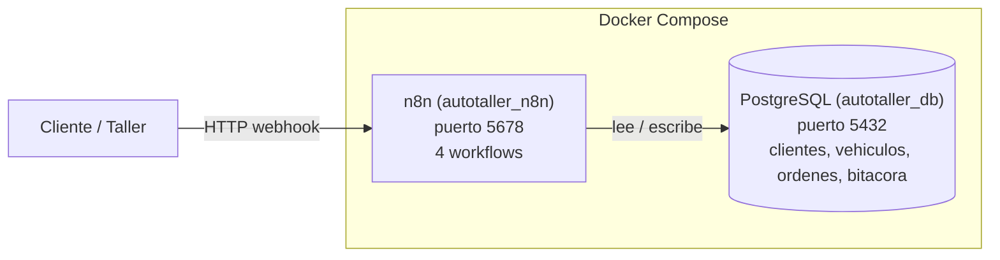
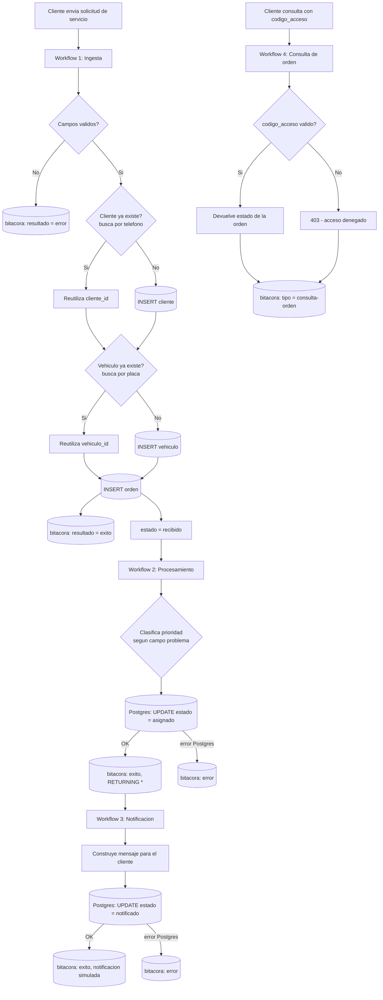
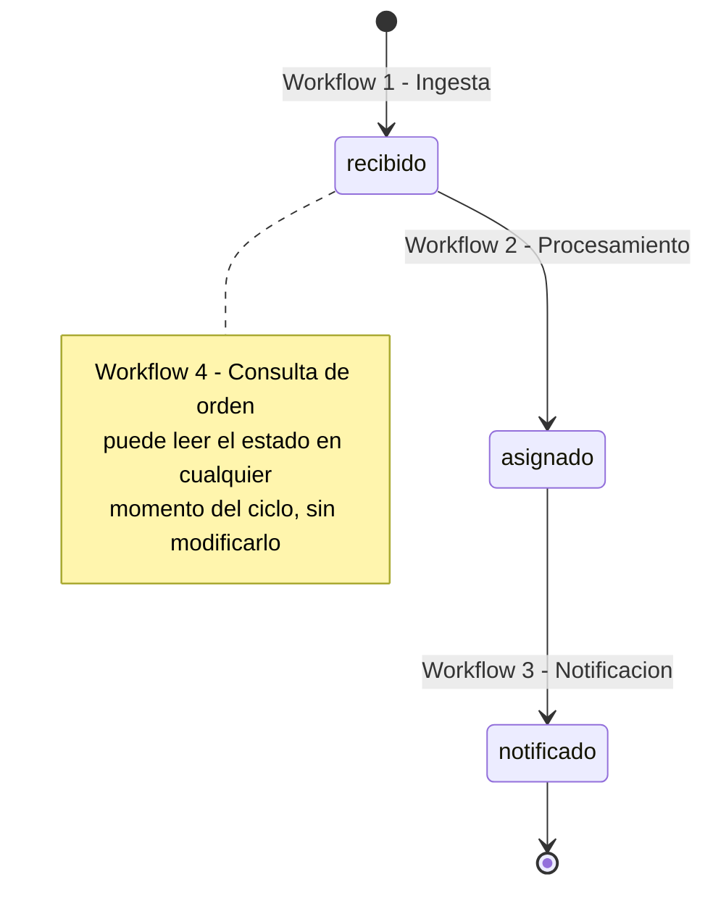

# AutoTaller - Automatizacion de Taller Mecanico con n8n y PostgreSQL

Sistema de automatizacion para un taller mecanico simulado, desarrollado como proyecto final del curso **Analisis de Sistemas II** (Universidad Mariano Galvez de Guatemala). El sistema gestiona el ciclo de vida de una orden de servicio, desde que el cliente la reporta hasta que se le notifica el resultado, usando **n8n** como motor de automatizacion y **PostgreSQL** como base de datos, todo orquestado con **Docker Compose**.

## Arquitectura



Ambos servicios corren en contenedores separados conectados por la red interna de Docker Compose; n8n se conecta a Postgres usando el nombre del servicio (`postgres`) como host, no `localhost`.

## Estructura del repositorio

```
autotaller-demo/
|-- docker-compose.yml       # Definicion de los servicios n8n + Postgres
|-- .env                     # Variables de entorno (NO se sube al repo)
|-- .gitignore                # Excluye .env, node_modules/, *.log
|-- init-db/
|   `-- schema.sql            # Esquema inicial, se ejecuta al crear el contenedor de Postgres
`-- workflows/
    |-- 01-ingesta-solicitud-servicio.json
    |-- 02-procesamiento-de-ordenes.json
    |-- 03-notificacion-de-ordenes.json
    `-- 04-consulta-de-orden.json
```

## Requisitos previos

- Docker Desktop (con WSL2 en Windows)
- Puertos libres: `5432` (Postgres) y `5678` (n8n)

## Variables de entorno

Crear un archivo `.env` en la raiz del proyecto (no se incluye en el repo por seguridad) con las siguientes variables:

```env
POSTGRES_USER=
POSTGRES_PASSWORD=
POSTGRES_DB=autotaller
N8N_USER=
N8N_PASSWORD=
```

## Como levantar el proyecto

```bash
docker-compose up -d
```

Esto crea dos contenedores:
- `autotaller_db`: PostgreSQL 16, con el esquema inicial aplicado automaticamente desde `init-db/schema.sql`
- `autotaller_n8n`: n8n, accesible en `http://localhost:5678`

Para detener sin borrar datos: `docker stop autotaller_n8n autotaller_db`
Para volver a iniciar: `docker start autotaller_db autotaller_n8n`

## Importar los workflows

Desde la interfaz de n8n (`localhost:5678`):
1. Ir a **Workflows -> Import from File**
2. Importar cada archivo `.json` de la carpeta `workflows/`
3. **Reasignar manualmente las credenciales de Postgres** en cada nodo que las use (n8n no las conserva al importar)
4. Publicar (**Activate**) cada workflow para que sus webhooks/triggers queden operativos

## Base de datos

| Tabla | Proposito |
|---|---|
| `clientes` | Datos del cliente (nombre, telefono) |
| `vehiculos` | Vehiculo asociado a un cliente (placa, marca, modelo) |
| `ordenes` | Orden de servicio: problema reportado, estado, codigo de acceso unico |
| `bitacora` | Auditoria: registra cada ejecucion de cada workflow (exito o error), con el payload recibido en JSONB |

El campo `ordenes.estado` avanza asi: `recibido -> asignado -> notificado`.
El campo `ordenes.codigo_acceso` permite al cliente consultar su orden sin autenticacion completa (control de acceso simple).

## Workflows

### 1. Ingesta de solicitud de servicio
Recibe una nueva solicitud de servicio via webhook y valida los campos requeridos. Antes de crear registros nuevos, busca si el cliente (por `telefono`) o el vehiculo (por `placa`) ya existen: si los encuentra, reutiliza su id; si no, los crea. Esto evita duplicar clientes/vehiculos cuando el mismo cliente genera varias ordenes. Luego registra la orden en la base de datos. Cada intento (exitoso o fallido) se registra en `bitacora`.

### 2. Procesamiento y clasificacion
Lee las ordenes en estado `recibido`, clasifica la prioridad (`alta` / `normal`) segun el campo `problema`, actualiza el estado a `asignado` y registra el resultado en `bitacora` (incluyendo la fila completa actualizada via `RETURNING *`).

### 3. Notificacion
Lee las ordenes en estado `asignado`, construye el mensaje de notificacion al cliente y actualiza el estado a `notificado`. La notificacion se simula registrandola en `bitacora` (no se envia correo real via SMTP).

### 4. Consulta de orden (control de acceso)
Webhook que recibe un `codigo_acceso` y devuelve el estado de la orden si el codigo es valido, o un `403 - acceso denegado` si no lo es. Ambos casos quedan registrados en `bitacora` bajo el tipo `consulta-orden`.

## Diagrama de flujo de los workflows



## Diagrama de estados de la orden



## Manejo de errores

Cada nodo de actualizacion en Postgres usa la opcion **"Continue Using Error Output"**, conectada a un nodo dedicado que inserta en `bitacora` con `resultado = 'error'` y el mensaje real de error de Postgres (via `JSON.stringify($json)`). Esto garantiza que ningun fallo detenga el workflow silenciosamente y que todo quede auditado.

## Seguridad

- Credenciales de base de datos y de n8n fuera del codigo, inyectadas por variables de entorno (`.env`, excluido del repo via `.gitignore`)
- Autenticacion basica habilitada en n8n (`N8N_BASIC_AUTH_ACTIVE`)
- Control de acceso a las ordenes mediante codigo unico no secuencial (`codigo_acceso`)

## Estado del proyecto

- [Hecho] Los 4 workflows construidos y probados end-to-end (ciclo completo: recibido -> asignado -> notificado)
- [Hecho] Manejo de errores explicito en los workflows 2, 3 y 4
- [Hecho] Variables sensibles externalizadas y `.gitignore` configurado
- [Hecho] Workflow 1 evita duplicar clientes/vehiculos: reutiliza el registro existente por telefono/placa antes de insertar uno nuevo
- [Pendiente] Ficha de inscripcion del proyecto (seccion 7 de la guia)

## Autor

Victor Juan de Dios Garcia Leonardo - Universidad Mariano Galvez de Guatemala, Ingenieria en Sistemas
